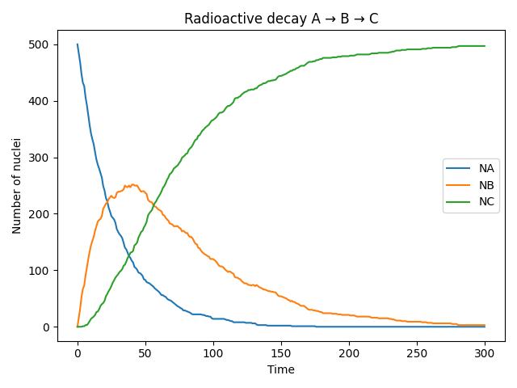
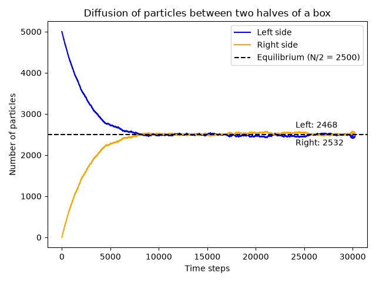
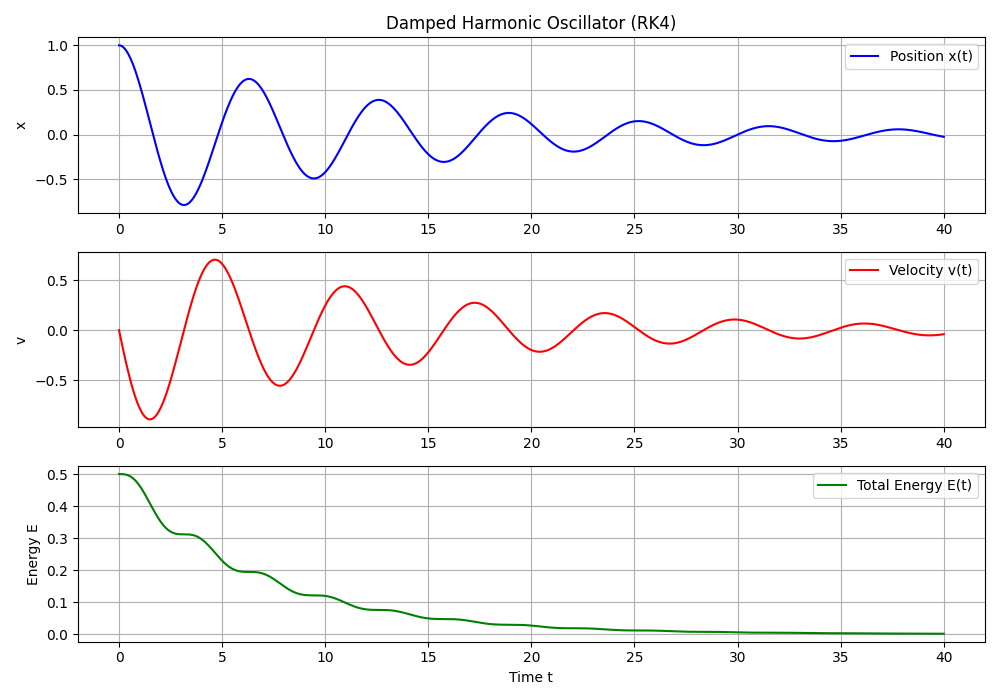
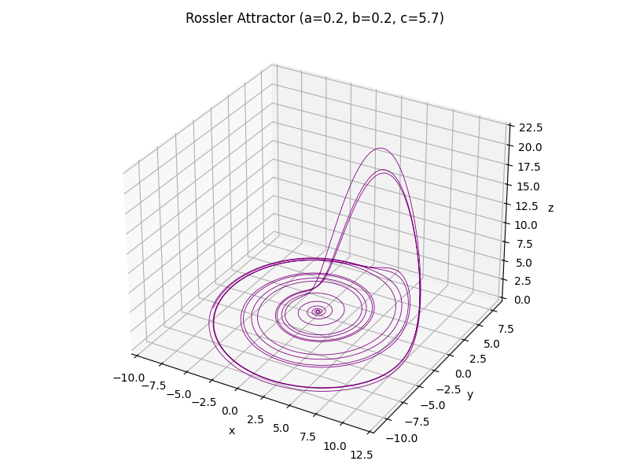
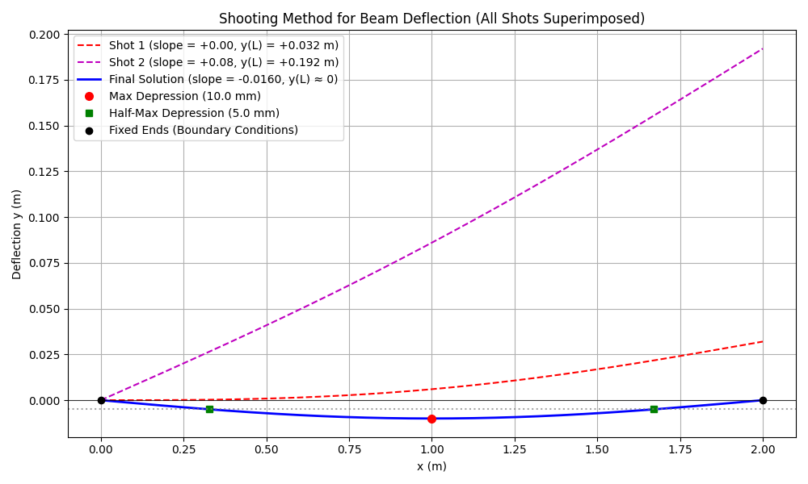
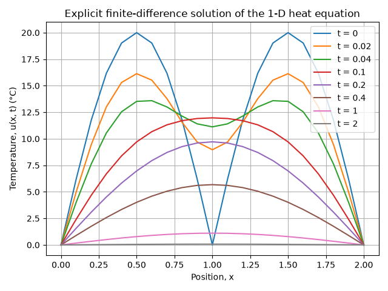
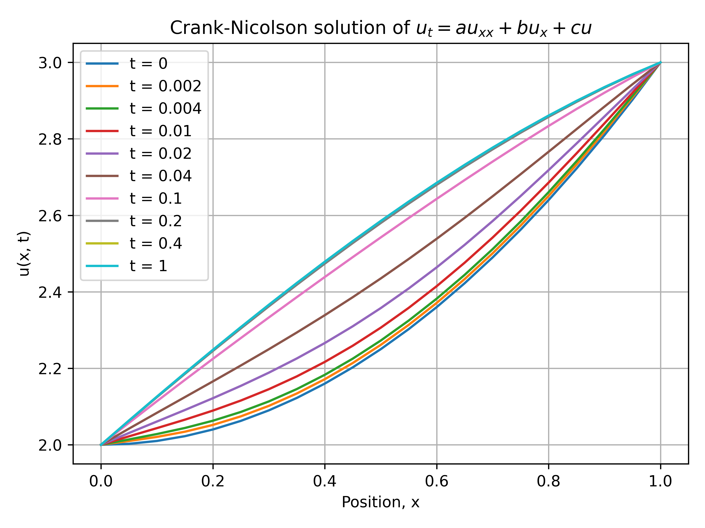
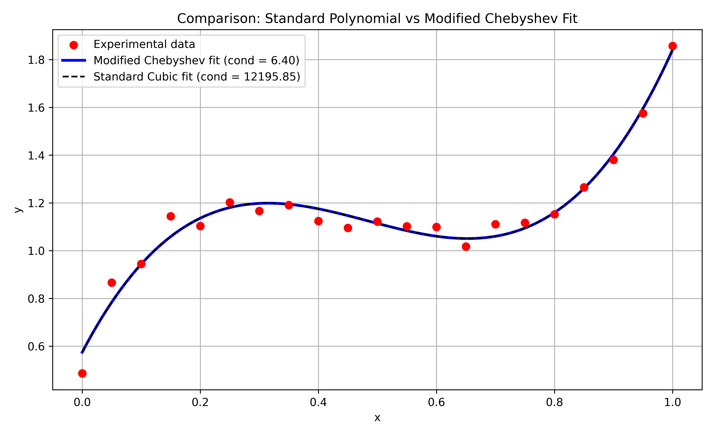

# Computational Physics Laboratory (PHY341 / PHY745)

[](https://www.python.org/)
[](LICENSE)
[](https://www.niser.ac.in)
[-brightgreen.svg)](#design-philosophy)

**Author:** [Aryan Bandyopadhyay](https://github.com/Aryans-lab)  
**Roll Number:** 2411014  
**Affiliation:** School of Physical Sciences, National Institute of Science Education and Research (NISER), Bhubaneswar  
**Course Reference:** PHY341 / PHY745 — Physics Computer Laboratory  

---

## Overview

This repository contains numerical algorithms, simulations, and lab assignment solutions developed from first principles in native Python.

Under the laboratory guidelines, core numerical methods are built without relying on high-level numerical solvers (`scipy`, `numpy.linalg`, or standard library `random`). All linear algebra, root-finding, quadrature, ODE/PDE integrators, eigenvalue methods, and regression techniques are implemented directly from scratch in a unified central library ([`mylib.py`](mylib.py)).

### Key Principles
- **First-Principles Implementation:** Core algorithms use standard library Python to maintain transparency over underlying mathematics, floating-point behaviour, and convergence properties.
- **Central Library Architecture:** All reusable routines live in [`mylib.py`](mylib.py); assignment scripts handle file I/O, routine invocation, and visualization.
- **Non-Interactive File I/O:** Matrices, vectors, and simulation parameters are read from and written to external ASCII data files.
- **Verification Diagnostics:** Solutions are verified against theoretical bounds, exact analytical forms, and residual checks ($\|Ax - b\|_2 \approx 10^{-16}$).

---

## Visual Gallery

### 1. Stochastic Kinetics & Particle Diffusion
Simulations of multi-state radioactive decay chains ($A \to B \to C$) using transition probabilities with an LCG pseudo-random generator, and microscopic particle equilibration across two compartments in the Ehrenfest diffusion model.

<p align="center">
  
  
</p>

### 2. Chaotic Dynamics & Damped Oscillators (RK4)
Fourth-order Runge-Kutta numerical integration applied to damped simple harmonic motion (monitoring phase space and energy dissipation $E(t)$) and continuous 3D phase-space trajectories of the non-linear chaotic Rössler attractor ($a=0.2, b=0.2, c=5.7$).

<p align="center">
  
  
</p>

### 3. Boundary Value Problems & Heat Diffusion (PDEs)
Cantilever beam deflection under load solved via the Shooting Method with RK4, and thermal relaxation on a metal rod using explicit FTCS and unconditionally stable Crank-Nicolson finite-difference schemes.

<p align="center">
  
  
</p>
<p align="center">
  
</p>

### 4. Data Fitting: Monomial vs. Shifted Chebyshev Orthogonal Basis
Comparison of cubic polynomial regression using standard monomial basis ($x^k$, ill-conditioned Hankel matrix) versus shifted Chebyshev orthogonal polynomials ($\phi_m(x) = T_m(2x - 1)$ on $[0, 1]$), illustrating matrix conditioning and numerical stability.

<p align="center">
  
</p>

---

## Library Blueprint (`mylib.py`)

The central engine [`mylib.py`](mylib.py) is organized into 13 mathematical modules:

```
mylib.py
├── 1. Random Number Generation & Stochastic Simulations (LCG, Uniform, Exponential, Ehrenfest)
├── 2. Complex Number Algebra (MyComplex class with arithmetic operator overloading)
├── 3. Matrix & Vector Utilities / File I/O (I/O, Transpose, Norms, Frobenius Norm, Residuals)
├── 4. Direct Linear Solvers (Gauss-Jordan, Matrix Inversion, Doolittle LU, Determinants)
├── 5. Symmetric Positive-Definite Systems (Cholesky Factorization & Solver)
├── 6. Iterative Linear Solvers (Jacobi, Gauss-Seidel, Successive Over-Relaxation [SOR])
├── 7. Non-Linear Root Finding (Bisection, Regula Falsi, Fixed-Point, 1D & Multivariable Newton-Raphson)
├── 8. Polynomial Algebra & Roots (Horner's Scheme, Laguerre's Method, Synthetic Deflation)
├── 9. Numerical Quadrature (Midpoint, Trapezoidal, Simpson 1/3, Monte Carlo, Gauss-Legendre, Gauss-Laguerre)
├── 10. Ordinary Differential Equations (Forward Euler, Backward Euler, Predictor-Corrector, RK4, Shooting)
├── 11. Partial Differential Equations (Thomas Algorithm, FTCS Explicit, BTCS Implicit, Crank-Nicolson, 1D Wave)
├── 12. Eigenvalue Problems (Power Iteration with Rayleigh Quotient, Matrix Deflation)
└── 13. Interpolation & Data Fitting (Lagrange Interpolation, Weighted Linear Regression, Polynomial & Chebyshev Fit)
```

### Module Reference Table

| Category | Routines | Description / Order |
|---|---|---|
| **RNG & Distributions** | `myrand`, `random_uniform`, `random_exponential`, `ehrenfest_diffusion` | Linear Congruential Generator ($a=1103515245, c=12345, m=32768$), inverse transform sampling |
| **Complex Numbers** | `MyComplex` | Object-oriented complex arithmetic (`+`, `-`, `*`, `/`, `abs`, conjugate) |
| **Matrix Utilities** | `read_matrix_from_file`, `write_matrix_to_file`, `matrix_multiply`, `matrix_transpose`, `vector_norm`, `frobenius_norm`, `matrix_residual` | ASCII file I/O supporting fractions, matrix operations, norms, residual checks |
| **Direct Solvers** | `gauss_jordan_elimination_augmented`, `gauss_jordan_inverse`, `lu_decomposition`, `lu_forback`, `matrix_determinant_lu`, `lu_inverse` | Row partial pivoting, Doolittle LU ($L_{ii}=1$), forward/backward substitution |
| **Cholesky Solver** | `is_symmetric`, `cholesky_decomposition`, `cholesky_forback` | Factorization $A = L L^T$ for symmetric positive-definite systems |
| **Iterative Solvers** | `is_diagonally_dominant`, `jacobi_it`, `gauss_seidel`, `sor_gauss_seidel` | Stationary iterative relaxation; SOR with tunable parameter $\omega \in (1, 2)$ |
| **Root Finding** | `bracket_root`, `bisection`, `regula_falsi`, `fixed_point`, `newton_raphson`, `newton_raphson_system` | 1D and multivariable root isolation using analytical or numerical Jacobians |
| **Polynomials** | `polynomial_value`, `laguerre`, `synthetic_division`, `laguerre_roots` | Horner's method, Laguerre root isolation, synthetic division deflation |
| **Quadrature** | `midpoint`, `trapezoidal`, `simpson`, `monte_carlo`, `gaussian_quadrature` | Newton-Cotes composite formulas, uniform Monte Carlo with variance, Gauss-Legendre/Laguerre ($N \le 6$) |
| **ODEs** | `euler`, `predictor_corrector`, `rk4`, `lagrange_linear_interpolation`, `fem_1d_poisson` | Explicit/implicit Euler, Heun predictor-corrector, RK4 for coupled/2nd-order ODEs, shooting method, 1D FEM |
| **PDEs** | `thomas_algorithm`, `pde_heat_1d_explicit`, `pde_heat_1d_implicit`, `pde_heat_1d_crank_nicolson`, `pde_wave_1d_explicit`, `pde_laplace_poisson_2d` | Tridiagonal solver (TDMA), parabolic FTCS/BTCS/Crank-Nicolson, 1D hyperbolic wave, 2D elliptic SOR |
| **Eigenvalues** | `power_iteration` | Dominant eigenvalue/eigenvector via Rayleigh quotient; subdominant extraction via matrix deflation |
| **Data Fitting** | `lagrange_interpolation`, `linear_regression`, `poly_eval`, `poly_fit`, `modified_chebyshev_basis`, `chebyshev_fit` | Lagrange polynomial, weighted least squares ($r^2$), polynomial regression with condition numbers, shifted Chebyshev basis |

---

## Directory & Assignment Index

| Directory | Topic / Focus | Key Problems Solved |
|---|---|---|
| [`Assgn0/`](Assgn0/) | Numerical Warmup & Complex Numbers | Series summation without formulas, matrix file I/O, `MyComplex` arithmetic class |
| [`assign1_rand/`](assign1_rand/) | RNG & Monte Carlo Basics | LCG period and lag correlation checks, Monte Carlo $\pi$ estimation, radioactive decay series ($A \to B \to C$) |
| [`assign2_gj_lu/`](assign2_gj_lu/) | Gauss-Jordan & LU Factorization | Gauss-Jordan with row pivoting, matrix inversion, Doolittle LU factorization |
| [`assign3_lu_chsk/`](assign3_lu_chsk/) | LU Substitution & Cholesky | Solving $6 \times 6$ systems via forward/backward substitution, Cholesky factorization for SPD systems |
| [`assign4_jac_gs/`](assign4_jac_gs/) | Iterative Linear Solvers | Jacobi, Gauss-Seidel, and Successive Over-Relaxation (SOR) spectral convergence comparisons |
| [`assign5_bi_rf/`](assign5_bi_rf/) | Bracketing Root Finders | Automated root bracketing, Bisection, and Regula Falsi methods on transcendental functions |
| [`assign5_fx_nr/`](assign5_fx_nr/) | Newton-Raphson & Multivariable Roots | Fixed-point Picard iteration, 1D Newton-Raphson, and multivariable coupled non-linear system solving |
| [`assign5_poly/`](assign5_poly/) | Polynomial Roots & Deflation | Horner evaluation, Laguerre method for real/complex roots, synthetic division deflation |
| [`assign6_midtrap/`](assign6_midtrap/) | Newton-Cotes Quadrature | Composite Midpoint and Trapezoidal integration with analytical error bound benchmarks |
| [`assign6b_simmc/`](assign6b_simmc/) | Simpson & Monte Carlo Quadrature | Simpson's 1/3-rule with 4th derivative bound estimation, Monte Carlo variance scaling ($O(N^{-1/2})$) |
| [`assign6c_gq/`](assign6c_gq/) | Orthogonal Quadrature | Gauss-Legendre on $[-1, 1]$ and Gauss-Laguerre on $[0, \infty)$ with tabulated weights ($N \le 6$) |
| [`Midsem/`](Midsem/) | Mid-Semester Examination Suite | Ehrenfest diffusion kinetics, LU matrix inversion, Wien's constant, beam center of mass, hydrogen $\langle r \rangle$ |
| [`assign7a_fwbk/`](assign7a_fwbk/) | Euler & Predictor-Corrector ODEs | Forward Euler, implicit Backward Euler (Newton solver), Heun predictor-corrector for stiff/non-linear ODEs |
| [`assign7b_rk4/`](assign7b_rk4/) | Runge-Kutta 4th-Order (RK4) | Unified scalar/coupled RK4, damped SHO phase portrait and energy decay, 3D chaotic Rössler attractor |
| [`assign7c_sht/`](assign7c_sht/) | Two-Point Boundary Value Problems | Shooting Method (RK4 + interpolation) for cantilever beam depression, uninsulated rod heat loss, 1D FEM |
| [`assign7d_felem/`](assign7d_felem/) | Partial Differential Equations | Explicit FTCS 1D heat equation, Crank-Nicolson method for generalized convection-diffusion-reaction PDE |
| [`assign8_eval/`](assign8_eval/) | Eigenvalue Problems | Power iteration method with Rayleigh quotient, outer-product deflation, validation on 5x5 tridiagonal spectrum |
| [`assign9a_fit/`](assign9a_fit/) | Interpolation & Model Comparison | Lagrange polynomial interpolation with ascending power coefficients, power law vs. exponential fit via Pearson $r^2$ |
| [`assign9b_fit/`](assign9b_fit/) | Polynomial & Chebyshev Regression | Standard polynomial least squares of order $k$, Hankel matrix condition numbers, modified Chebyshev basis fitting |
| [`Slides/`](Slides/) | Lecture Notes & Slide Decks | Course reference slides provided by the instructor covering all topics |
| [`helper/`](helper/) | Course Reference & Notes | Comprehensive master study notes ([`Computational_Physics_Complete_Notes.md`](helper/Computational_Physics_Complete_Notes.md)) and course templates |

---

## Quickstart Examples

### 1. Solving a Linear System ($Ax = b$)
```python
from mylib import lu_forback, matrix_residual

A = [
    [4.0, 1.0, -1.0],
    [1.0, 4.0, -1.0],
    [-1.0, -1.0, 5.0]
]
b = [6.0, 25.0, -11.0]

# Solve via Doolittle LU decomposition
x = lu_forback(A, b, method='lu')
print("Solution:", [round(val, 6) for val in x])

# Verify numerical integrity via residual norm ||Ax - b||
res = matrix_residual(A, x, b)
print(f"Residual norm: {res:.2e}")
```

### 2. Integrating Coupled ODEs via RK4 (Damped Oscillator)
```python
import math
from mylib import rk4

# State: y = [x, v], dy/dt = [v, -mu*v - omega^2*x]
mu, omega_sq = 0.15, 1.0
def damped_sho(t, state):
    x, v = state
    return [v, -mu * v - omega_sq * x]

# Initial conditions: x(0) = 1.0, v(0) = 0.0 over t in [0, 40]
t_vals, sol = rk4(damped_sho, a=0.0, b=40.0, y0=[1.0, 0.0], h=0.05)
print(f"Computed {len(t_vals)} trajectory points. Final position: {sol[-1][0]:.4f}")
```

### 3. Finding Dominant Eigenvalue (Power Iteration)
```python
from mylib import power_iteration

A = [
    [4.0, 2.0/3.0, -4.0/3.0, 4.0/3.0],
    [2.0/3.0, 4.0, 0.0, 0.0],
    [-4.0/3.0, 0.0, 6.0, 2.0],
    [4.0/3.0, 0.0, 2.0, 6.0]
]

eigenvalue, eigenvector, iters = power_iteration(A, tolerance=1e-8)
print(f"Dominant eigenvalue: {eigenvalue:.6f} (converged in {iters} iterations)")
print("Eigenvector:", [round(v, 6) for v in eigenvector])
```

### 4. Least-Squares Fitting: Monomial vs. Shifted Chebyshev Basis
```python
from mylib import poly_fit, chebyshev_fit

data = [[0.1, 1.2], [0.25, 1.8], [0.5, 3.1], [0.75, 5.0], [0.9, 7.3]]

# Standard cubic monomial fit: returns coefficients, Hankel matrix, and condition number
c_poly, A_poly, cond_poly = poly_fit(data, k=3)
# Shifted Chebyshev fit on [0, 1]
c_cheb, A_cheb = chebyshev_fit(data, k=3)

print("Standard monomial coefficients:", [round(c, 4) for c in c_poly])
print(f"Condition number (Hankel matrix): {cond_poly:.2f}")
print("Shifted Chebyshev coefficients:", [round(c, 4) for c in c_cheb])
```

---

## Academic Context

Developed by **Aryan Bandyopadhyay** (`2411014`), Integrated M.Sc. Physics student at the **National Institute of Science Education and Research (NISER)**, Bhubaneswar.

Detailed notes on algorithms, mathematical proofs, and examination questions are compiled in [`helper/Computational_Physics_Complete_Notes.md`](helper/Computational_Physics_Complete_Notes.md). Course requirements and context are documented in [`COURSE_CONTEXT.md`](COURSE_CONTEXT.md).

---

## License

This project is licensed under the [MIT License](LICENSE).
