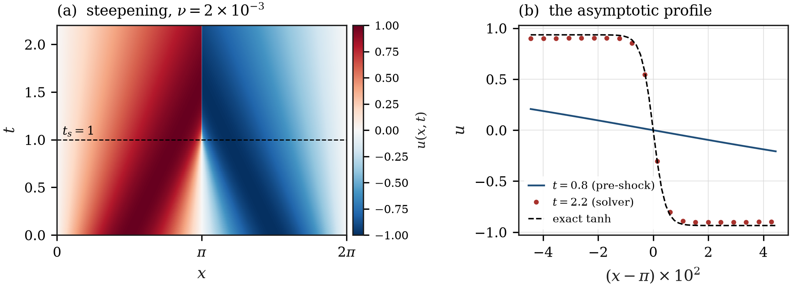
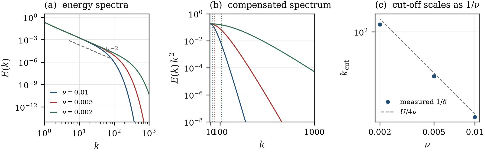
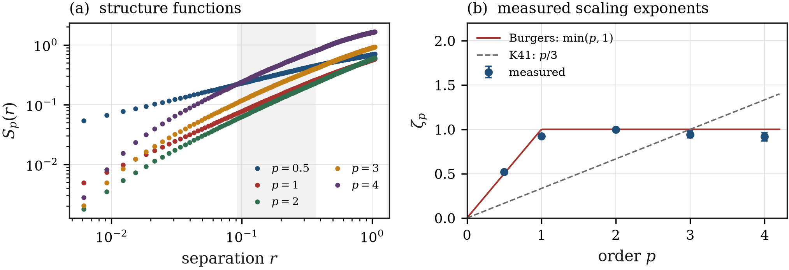
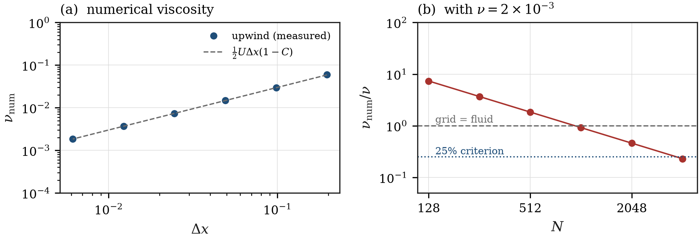

# Shock waves in a 1-D fluid

### Numerical study of the viscous Burgers equation — the 1-D Navier–Stokes equation

**DIY project · PHY341 / PHY745 Physics Computer Lab · NISER Bhubaneswar**
Aryan Bandyopadhyay (2411014) · Instructor: Prof. Subhasish Basak

---

## The question

In one spatial dimension the incompressibility constraint kills both advection
and the pressure gradient, so the only dynamically non-trivial reduction of the
Navier–Stokes equation is the **viscous Burgers equation**

$$u_t + u\,u_x = \nu\,u_{xx}, \qquad x\in[0,2\pi),\ \text{periodic}.$$

It contains exactly two competing effects: nonlinearity, which steepens the
wave until it breaks, and viscosity, which smooths it. This project asks a
question that is really about *computation* rather than about fluids:

> **When a shock is only a few grid points wide, which features of the flow are
> physics and which are properties of the mesh?**

Everything below is measured against an analytic answer, so the numerical error
is never allowed to masquerade as a result.

---

## Headline results

| # | Result | Prediction | Measured |
|---|---|---|---|
| 1 | Order of convergence in $\Delta x$ | upwind 1, Lax–Wendroff 2, Crank–Nicolson 2, spectral exponential | 0.94, 2.02, 2.00, $7.5\times10^{-4}\to 1\times10^{-9}$ |
| 2 | von Neumann growth of the grid-scale mode | $-82.3$, $+55.0$, $-1.66$ per unit time | $-82.1$, $+55.1$, $-1.66$ |
| 3 | Shock formation time, $u_0=\sin x$ | $t_s = -1/\min u_0' = 1$ | characteristics cross at $t=1.00$ |
| 4 | Maximum strain after breaking | $U^2/2\nu = 250$ | $247.5$ |
| 5 | Shock thickness | $\delta = 4\nu/U$ | $\delta \propto \nu^{0.985}$, prefactor 1.05–1.10 |
| 6 | Energy spectrum | $E(k)\propto k^{-2}$ | $k^{-2.030 \pm 0.001}$ |
| 7 | Spectral cut-off | $k_{\rm cut} = U/4\nu$ | $k_{\rm cut}\propto \nu^{-0.971}$ |
| 8 | Structure-function exponents (Burgulence) | $\zeta_p = \min(p,1)$ | $0.52,\ 0.92,\ 1.00,\ 0.94,\ 0.92$ for $p=0.5,1,2,3,4$ |
| 9 | Numerical viscosity of first-order upwind | $\nu_{\rm num}=\tfrac12 U\Delta x(1-C)$ | ratio to theory $1.00$ over 5 decades, $\nu_{\rm num}\propto\Delta x^{1.003}$ |
| 10 | Grid viscosity at $N=256$, $\nu=2\times10^{-3}$ | — | $\nu_{\rm num} = 3.7\,\nu$ |

<p align="center">
  
</p>

*Left:* the wave steepens and breaks at $t_s=1$; after that the profile is a
shock of fixed thickness. *Right:* the asymptotic profile at $t=2.2$ against the
exact steady solution $u=-U\tanh[U(x-\pi)/2\nu]$ — the solver reproduces it to
within the marker size.

<p align="center">
  
</p>

*Left:* energy spectra for three viscosities collapse onto $E\propto k^{-2}$
and separate only at the dissipative cut-off. *Middle:* the compensated
spectrum makes the cut-off visible as a knee. *Right:* the cut-off is inversely
proportional to viscosity, as the tanh profile requires.

<p align="center">
  
</p>

*Left:* structure functions $S_p(r)$ for a random shock train, with the fitting
window shaded. *Right:* the measured exponents sit on the bifractal prediction
$\zeta_p=\min(p,1)$ and far from the Kolmogorov $p/3$ — a factor of three apart
at $p=4$.

<p align="center">
  
</p>

*Left:* the numerical viscosity of the upwind scheme, measured from the damping
of a single Fourier mode, follows $\tfrac12U\Delta x(1-C)$ to 1% over five
decades in $\Delta x$. *Right:* compared with a physical $\nu=2\times10^{-3}$,
the grid is more viscous than the fluid below $N\approx1024$.

---

## The five experiments

| Script | What it establishes | Figures |
|---|---|---|
| `e1_validation.py` | Four schemes converge at their advertised order; the explicit stability boundary is exactly where von Neumann theory puts it. | `fig01` |
| `e2_shock_formation.py` | The wave breaks at $t_s=1$; the strain diverges as $1/(t_s-t)$ and saturates at $U^2/2\nu$; the shock thickness is $4\nu/U$. | `fig02`, `fig03` |
| `e3_spectra.py` | The Fourier spectrum of a shock train is $k^{-2}$; viscosity sets only the cut-off, which scales as $1/\nu$. | `fig04` |
| `e4_structure_functions.py` | For random initial data the flow becomes Burgulence: $\zeta_p=\min(p,1)$, not Kolmogorov's $p/3$. | `fig05` |
| `e5_grid_viscosity.py` | Grid viscosity is measurable and predictable; on a coarse mesh it dominates the fluid. | `fig06` |

---

## Quick start

```bash
pip install -r requirements.txt

python run_all.py            # all five experiments (~10 min) -> figures/ results/
python run_all.py e2 e5      # a subset
python tests/test_core.py    # 15 correctness checks
```

Every run writes its console output to `results/*.txt` and its numbers to
`results/*.json` / `*.csv`, so each figure in the report can be traced back to a
specific run. Figures are written as vector PDF (for LaTeX) and PNG (for slides).

---

## How it is built

The project follows the laboratory's rule that numerical methods are
implemented, not imported. `numpy` is used for arrays and vectorised arithmetic
only; `np.fft`, `np.linalg` and `scipy` are never called.

```
project_burgulence/
├── src/
│   ├── fftlib.py        radix-2 FFT, spectral derivative, band-limited interpolation
│   ├── solvers.py       spectral (Strang + RK4), upwind, Lax–Wendroff, FTCS, Crank–Nicolson
│   ├── exact.py         Cole–Hopf solution, characteristics, exact tanh shock
│   ├── diagnostics.py   spectra, structure functions, shock width, fits, block averaging
│   ├── common.py        paths, initial conditions (myrand!), bookkeeping
│   └── style.py         one visual identity for all figures
├── experiments/         e1 … e5, one script per result
├── figures/             generated, never hand-edited
├── results/             console logs and CSV/JSON of every quoted number
├── report/              LaTeX skeleton for the 4-page report + outline
├── slides/              beamer deck and a self-contained HTML deck
└── tests/               15 checks (FFT vs DFT, Cole–Hopf residual, conservation, …)
```

### Two pieces of the course library do real work here

* **`mylib.thomas_algorithm`** solves banded tridiagonal systems in
  Crank–Nicolson. The periodic case is reduced to two Thomas sweeps by a
  Sherman–Morrison correction (`solvers._cyclic_tridiagonal`).
* **`mylib.myrand`** (the course LCG) generates the random initial phases of the
  Burgulence ensemble, so experiment 4 is reproducible from the same generator
  used in the first assignment.

The only substantial new numerical component is the FFT, which the project
needs anyway — for the spectral solver *and* for the spectrum measurement — and
which is verified against a naive DFT to $10^{-15}$.

### The reference solution

Not a fine-grid run, but the exact Cole–Hopf solution

$$u = -2\nu\,\partial_x \ln\phi, \qquad \phi(x,t)=\int K(x-y,t)\,\phi_0(y)\,dy,
\qquad \phi_0 = e^{-\frac{1}{2\nu}\int_0^y u_0}.$$

The integral is evaluated with spectral accuracy on an 8192-point grid, and
the initial data is interpolated onto that grid *band-limited* rather than
linearly: linear interpolation of a coarse grid injects an $O(\Delta x^2)$
error into the benchmark itself (a mistake this project made and then fixed).
The reference is grid-independent to $10^{-12}$, which is what makes the
"spectral is exponentially convergent" claim in `fig01` meaningful.

---

## What surprised me

1. **A coarse grid does not make a shock *thicker* in the way one expects.**
   Below roughly five points per shock thickness the measured width locks onto
   $2\Delta x$ and stops responding to $\nu$ at all — the number is then a
   property of the mesh.
2. **Centred schemes are non-dissipative but dispersive, upwind is the
   reverse.** The same shock comes out smeared by upwind and ringed by
   Lax–Wendroff/Crank–Nicolson; neither is "more accurate" in general, they are
   wrong in different norms. `fig01` and `fig02` are the two halves of that
   statement.
3. **The exponents are robust even when the field is not.** $\zeta_p$ is
   insensitive to the detailed shock positions; it is a statement about the
   *distribution* of jumps, which is why a $k^{-2}$ spectrum survives a
   viscosity change by three orders of magnitude.

---

## References

1. J. Bec and K. Khanin, *Burgers turbulence*, Phys. Rep. **447**, 1–66 (2007).
2. J. M. Burgers, *A mathematical model illustrating the theory of turbulence*,
   Adv. Appl. Mech. **1**, 171–199 (1948).
3. G. B. Whitham, *Linear and Nonlinear Waves* (Wiley, 1974), ch. 2–4.
4. J. P. Boyd, *Chebyshev and Fourier Spectral Methods*, 2nd ed. (Dover, 2001).
5. R. J. LeVeque, *Finite Volume Methods for Hyperbolic Problems* (CUP, 2002).
6. P. A. Lagerstrom, *Matched Asymptotic Expansions* (Springer, 1988) — for the
   inner structure of the viscous shock.

Full annotated bibliography with DOIs: [`LITERATURE.md`](LITERATURE.md) and
[`refs.bib`](refs.bib).

---

## Report and presentation

* [`report/main.tex`](report/main.tex) — four-page LaTeX skeleton with the
  equations, figure placement and a results table already filled in.
* [`report/OUTLINE.md`](report/OUTLINE.md) — what each paragraph should say, in
  order, with the numbers to quote.
* [`slides/`](slides/) — a 17-slide beamer deck and a self-contained HTML deck
  that runs in any browser and prints to PDF.

---

## Licence

MIT, as the rest of the repository.
